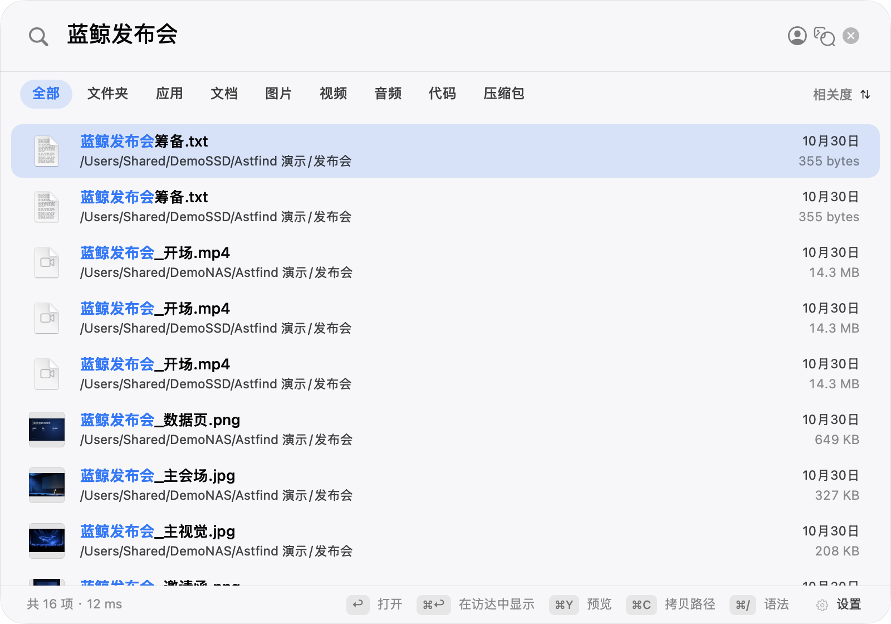
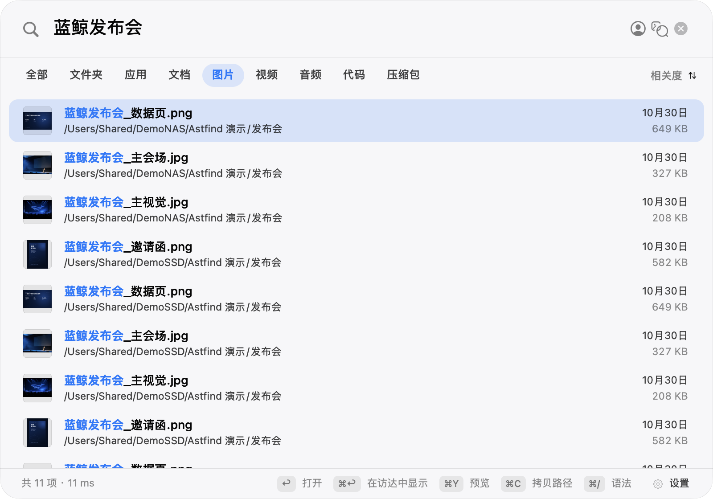
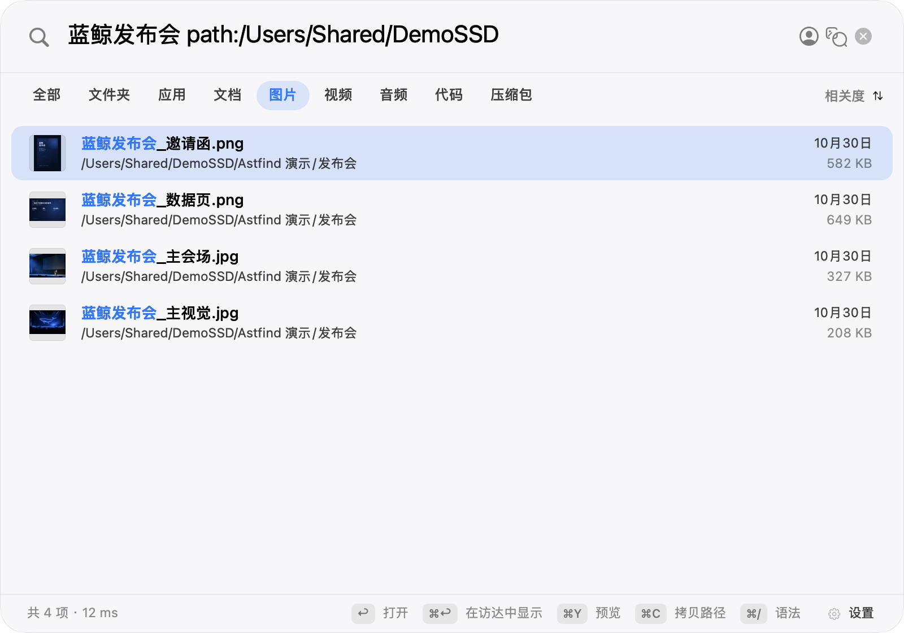

# Astfind

> macOS 本地优先的统一内容搜索——一个搜索框，找回散落在本机、移动硬盘和 NAS 里的文件**与内容**：文件名、文档正文、图片里的文字、视频里的文字，甚至**图片和视频的画面**（"讲台上的一位老师"这样的自然语言直接搜；也可以直接**以图搜图 / 以图搜视频**，或拿一张照片**找同一个人**）。

> 产品页：**https://astfind.robyn.top/**（Cloudflare Pages；源文件 `docs/index.html`）。
>
> 设计规范：[DESIGN.md](DESIGN.md)。页面、组件、CSS 与交互以此为准。部署步骤见 [docs/deploy-cloudflare.md](docs/deploy-cloudflare.md)。

[]() []() []() []() []()

> **v0.4.0（2026-11-03）**：新增人物检索（图片/视频关键帧、多脸选择、目录/全来源范围、召回阈值）、交互优先后台索引、按来源内容索引范围与任务去重。发布说明见 [docs/releases/v0.4.0.md](docs/releases/v0.4.0.md)。

## 效果一览

以下为 0.4.0 真实面板（⌥⇧F）截图，演示素材来自两个本地演示来源 **DemoSSD / DemoNAS**；均为虚构素材，不含真实个人路径或真实人脸：

**统一搜索**——「蓝鲸发布会」：正文、图片与视频命中混排；图片行带缩略图，视频行带来源路径：



**多源图片结果**——同一组图片来自 DemoSSD 与 DemoNAS 两个演示来源：



**路径筛选**——`path:/Users/Shared/DemoSSD` 只保留该来源的图片命中：



另有：视频帧文字 OCR、类别页签过滤（图片/视频/文档…对主结果与补充命中同样生效）、来源离线保留（拔盘后仍可搜索）、设置页抽屉式来源/进度管理（默认收起，展开才轮询）与 Provider 配置。

## 以图搜图 / 以图搜视频（v0.4.0 + M0.7 增强）

搜索框右侧图片按钮、把图片拖进面板，或直接 `⌘V` 粘贴一张截图/图片文件：命中的图片与视频帧按相似度降序排列，视频结果带时间码，缩略图显示命中帧本身。

- 跨本机 / 外置盘 / NAS 同库检索；图片与视频帧同处一张向量表，**以图搜视频是零成本副产品**
- 查询图本地归一化（长边 ≤1024 JPEG），与入库缩略图同一预处理；同一张图重复查询不重复向量化
- **右键“找相似…”**：图片结果直接以该图继续检索；视频帧命中先按时间点抽帧，再以帧为参考图（8s 看门狗，失败不拿海报冒充）
- **视频命中跳时间点**：双击/回车时，默认播放器是 QuickTime 就用 AppleScript 定位并播放；其他播放器或拒绝自动化授权自动降级从头播放，右键仍可“从头播放”
- **图文联合查询**：图片模式下继续输入文字即“图 + 文”；优先同 Provider 的同空间向量加权融合（默认图片权重 0.7），融合不可用时降级为图片召回 + 文本过滤/重排，文本无命中仍保留纯图结果
- **访达服务入口**：Finder 右键图片 → 服务/快速操作 → “在 Astfind 中找相似”，直接以该图进入以图搜图（macOS Services，不是 Finder Sync 扩展）
- 需在设置中开启语义检索，且当前模型支持图片输入（WeMM 的 `imageInput: dataURL`）；模型不支持时入口隐藏
- 隐私边界不变：查询图只走当前语义模式，本地模式零外发，远程模式仍受外发门控制

**实测**：在 129,784 条真实向量库上，以一张本地图片为查询，5.2s 返回图片与带时间码的视频帧命中；图文联合查询（`semantic joint-search`）同库约 5.1–5.3s，NAS 坏文件读取有 15s 看门狗，不会吊死面板。

设计、缓存与验收记录见 [docs/image-query-design.md](docs/image-query-design.md)。

## 交互优先与内容索引范围（M0.6b）

- 面板可见/输入/打开/预览/QuickLook 时暂停新的后台扫描与内容抽取；隐藏后恢复，不重启 Scanner。
- 真实 UI 打开 p95 **900ms**；扫描暂停代理 p95 **142.8ms**。旧口径 33s 级退化不再出现。
- 按来源开关内容索引：大型照片库可只保留文件名/元数据，内容 OCR 可按来源关闭；任务可暂停、恢复，变更检测避免重复排队。
- 设置页显示“后台索引已暂停”“待索引内容”“内容提取进度/ETA”，支持“立即更新”。

## 人物检索 / 找人（实验功能）

- 参考照片 → 本机 Vision 人脸检测/五点对齐 → `buffalo_sc` CoreML 512 维向量 → 本机独立人脸索引。
- 图片与视频关键帧都支持；视频 2s 起采样、长视频自适应、最多 60 帧，命中带 `@mm:ss`。
- 合影参考图显示候选脸选择条（最多 6 张），切换主脸立即重查；结果按资产去重取最佳帧。
- 人脸索引按来源/目录范围：设置页可选择“整个来源”或来源内任意目录，不必为整库照片全量建库。
- 召回范围可调：严格 0.60 / 标准 0.50 / 宽松 0.35 / 高召回 0.25；同一参考图 0.5 命中 3 条，0.25 命中 14 条。
- 默认关闭；按来源开启；人脸表独立于 WeMM 向量；可随时“删除全部人脸数据”。
- M0.8a 域内 A/B：本机 `buffalo_sc` rank1 **98.0–98.9%**、Recall@10 **100%**、查询 P95 **778–855ms**。
- 授权活动视频验证：参考帧能命中同段视频并返回时间码。
- 授权活动照片验证：单张参考照片能返回人物与视频命中。
- **许可边界**：`buffalo_sc` 权重为非商用研究许可；当前仅内部试用，对外发布前需 SeetaFace6/SFace 或商业授权。权重不随仓库/App 分发。
- **模型安装**：`buffalo_sc` 的官方下载、SHA-256、ONNX → CoreML 转换与 App 内配置见 [模型下载与配置](docs/model-setup.md#二buffalo_sc人物检索模型)。

### 人脸通道参数

| 项目 | 当前参数 |
|---|---|
| 检测 / 对齐 | Apple Vision 人脸检测 + 五点对齐 |
| 识别输入 | 112×112 RGB/CHW float32，`(pixel-127.5)/127.5` |
| 识别模型 | `buffalo_sc` CoreML（`w600k_mbf`），512 维，L2 归一化 |
| 模型体积 | 13 MB（编译后 `mlmodelc`） |
| 单脸推理 | 约 4.1 ms（Apple Silicon 实测；仅模型前向，不含读图与检测） |
| 默认阈值 | 0.50；严格 0.60 / 标准 0.50 / 宽松 0.35 / 高召回 0.25 |
| 数据边界 | 本机推理，参考照片与人脸向量不出网；独立表，可删除 |
| 权重分发 | 不随仓库 / App 分发 |

### 自测结果与调优

以下均为项目自测，不是第三方认证或公开榜单。图像 A/B 来自两个授权活动，A/B 使用同一套 Vision 检测、五点对齐、112×112 预处理、查询集与候选集，只改变识别模型。

**图像检索 A/B**

| 活动 / 组 | rank1 | Recall@10 | 未知误返 | P95 |
|---|---:|---:|---:|---:|
| 人声乐团 A `buffalo_l`（远端） | 99.0% | 100% | 0/10 | 881 ms |
| 人声乐团 B `buffalo_sc`（本机） | 98.0% | 100% | 0/10 | 778 ms |
| 走秀 A `buffalo_l`（远端） | 98.9% | 100% | 0/10 | 852 ms |
| 走秀 B `buffalo_sc`（本机） | 98.9% | 100% | 0/10 | 855 ms |

**视频采样调优**

| 采样间隔 | 候选帧 | 覆盖人物 | 固定真值召回 |
|---:|---:|---:|---:|
| 10 s | 30 | 6 | 50.0% |
| 5 s | 38 | 6 | 50.0% |
| **2 s** | **73** | **9** | **100%** |
| 1 s | 131 | 9 | **100%** |

真值口径：30 段同活动短片、9 个人物、14 个出现区间，负责人人工确认。瓶颈是采样密度，不是识别模型；2s 作为默认，1s 作为高召回档。

**5k 帧索引成本**

| 组 | 构建 | 峰值 RSS | 存储 | 查询 P50 / P95 | 检索 P50 / P95 |
|---|---:|---:|---:|---:|---:|
| B 本机 `buffalo_sc` | 164.7 s | 314 MB | 34.2 MB | 507 / 1028 ms | 7.8 / 11.2 ms |
| A 远端 `buffalo_l` | 465.4 s | 274 MB | 34.3 MB | 446 / 1160 ms | 7.9 / 13.4 ms |

5,000 帧来自 497 段视频，共 5,358 个向量（1280px JPEG）。

**调优结论**

- 识别模型：本机 `buffalo_sc` 与远端 `buffalo_l` 在两个活动上的 rank1 差距 ≤1 个百分点，Recall@10 都为 100%；本机模式因此作为 MVP，`buffalo_l` 保留为后续增强对照。
- 视频采样：10s / 5s 的固定真值召回都是 50%，2s 达到 100%；瓶颈是采样密度，默认改为 2s，1s 作为高召回档。
- 索引成本：5k 帧本机构建 164.7s、存储 34.2MB；查询 P95 1028ms 处于 1s 目标边界，检索本身仅 8–13ms。

**口径与未决项**

- 未知人物集每个活动仅 10 个查询，0/10 不等于通用误返率；侧脸仍未解决（人声乐团 profile：A 88.9%、B 77.8%）。
- 5k 帧为 1280px，4K 原始帧和更大真实向量规模未测；50k 为合成诊断。
- 视频集仍小（30 段 / 9 人 / 14 区间），需要扩大复验。
- 评测管线按 profile 隔离，已接入 `buffalo_l` 作为远端 A 组；其他识别模型可按同一 `FaceBenchmarkEmbedder` / manifest 口径接入做 A/B 与阈值调优。
- 设计与模型边界：[人物检索设计](docs/person-search-design.md)、[模型下载与配置](docs/model-setup.md)。

## 基准与数据

**A0-b 本地多模态模型对比**（自建域内 612 图配对样本，174 为独立小抽样；非公开榜单）：

| 模型 | 真值 rank1 | MRR@20 | 单图 | 峰值内存 | 外发 |
|---|---:|---:|---:|---:|---|
| **WeMM-2B（本地）** | **11/11** | **1.000** | 1.06s | 4.76GB | 否 |
| WeMM-9B（远程） | 10/11 | 0.9545 | ≈0.7s（含网络） | — | 是 |
| EmbeddingGemma 2（本地） | 7/11 | 0.818 | 0.99s | 2.95GB | 否 |
| Chinese-CLIP B/16（参考） | 5/11 | 0.636 | 39.5ms | 2.2GB | 否 |

完整脱敏说明、逐条查询、地板与复现命令：[A0-b 本地多模态模型评测](docs/a0b-local-model-benchmark.md)；公开聚合数据见 [docs/data/a0b-benchmark-summary.json](docs/data/a0b-benchmark-summary.json)；逐条结果含真实路径不入库。

**人脸通道自测**（本机 `buffalo_sc` vs 远端 `buffalo_l`，两个授权活动；非公开榜单）：rank1 98.0–99.0%、Recall@10 100%、查询 P95 778–881 ms；运行参数、视频采样与 5k 帧索引成本见上方「人物检索 / 找人」。

- [语义模型设置](docs/semantic-model-mode-design.md)：关闭 / 远程 / 本地三态（已实现）；[本地服务启动指引](docs/local-semantic-server.md)
- [本地模型下载与显存要求](docs/local-semantic-server.md#模型选择与下载)：[WeMM-Embedding-2B](https://huggingface.co/tencent/WeMM-Embedding-2B) / [WeMM-Embedding-9B](https://huggingface.co/tencent/WeMM-Embedding-9B) / [EmbeddingGemma 2](https://huggingface.co/google/embeddinggemma-2)（含本项目实测、Apache-2.0 与 9B 显存说明；权重不随仓库分发）
- 默认语义模型不变（远程 WeMM-9B）；本地 WeMM-2B 需自行起服务，接入后零外发

## 核心能力（v0.4.0）

**搜索通道**（面板 ⌥⇧F，结果混排、命中带标签）

- 统一文件名搜索：本机 / USB / SSD / SMB NAS 多源合并；**源离线后索引保留可搜**（标「离线」禁打开），重连自动重扫
- 图片 OCR / PDF（含扫描件逐页 OCR）/ 纯文本 → 中文 FTS trigram 检索，命中片段高亮
- 视频帧文字：抽帧 OCR，命中带时间码【视频帧 @01:23】
- 图片 + 视频画面语义：多模态向量（int8 本地落库 4KB/条），自然语言搜画面，命中带相似度与帧时间码【语义 · 相似度 0.61 @06:50】
- **以图搜图 / 以图搜视频**：图片按钮、拖入或 ⌘V 粘贴；结果按相似度排序，视频命中带时间码与命中帧缩略图；右键找相似、视频跳时间点、图 + 文联合查询
- 类别页签（图片/视频/文档/音频/代码/压缩包）对全部通道生效
- **人物检索 / 找人**：参考照片 → 本机人脸向量 → 图片/视频命中；合影多脸选择、视频时间码、按来源开关
- **交互优先后台索引**：面板/预览/打开时暂停新后台 I/O，隐藏后恢复；大型来源可按来源关闭内容 OCR

**工程与可靠性**

- A1 Provider 协议体系：能力显式声明 + 探测实测（声明≠能力）、失败分类（配置类不重试 / 环境类退避）、**外发门默认拒绝**（仅本机回环放行，显式授权才外发）
- 语义模型三态（关闭 / 远程 / 本地）：模式即发送边界——本地只允许回环端点，远程未授权零请求，关闭不注册图片 Provider；切换模型不静默重嵌，向量空间按模型+维度隔离
- 入库批量多图单请求（实测 2.5~2.9x）+ 流式攒批读写重叠 + 批失败二分隔离毒图/毒帧 + 证据式毒图隔离（连续失败 10 次终态跳过，纯宕机零误杀）
- 失联恢复三层阶梯：SMB 身份绑定（`smb://host/share`，换挂载点自动重绑）/ PR 式手动重链接（锚点定位+抽样校验）/ 设置页入口
- 热路径时延解耦：文件名结果先行，OCR/正文毫秒级追加，语义异步二波并入——任何增强通道不拖慢基础搜索
- 内容任务 checkpoint：已完成且 size:mtime 未变的资产在入队层跳过，重启/重扫不再反复排队；视频 OCR 开关会显式重置对应 done 任务

**实测规模**：三源（NAS×2 + USB SSD）106,686 张图片 + 3,850 个视频；单库 10 万级向量本地暴力扫描毫秒级。

## 使用

### 安装（Apple Silicon）

- **DMG**：从 [Releases](https://github.com/artrobin-cn/astfind/releases) 下载，拖入「应用程序」。未公证，首次打开需在「系统设置 → 隐私与安全性」放行。
- **npm**（Node.js 18+）：`npm install -g astfind && astfind`。装到 `~/Applications`，无需 sudo；安装前校验 SHA-256、bundle ID、arm64 与代码签名完整性。
- **Homebrew**（发布后）：`brew install --cask artrobin-cn/astfind/astfind`。

### 从源码

```bash
# 构建（269/269 测试）
cd AstfindKit
swift test
./scripts/build-astfind-app.sh        # → build/Astfind-0.4.0.dmg

# CLI（来源管理与无头验证）
.build/debug/astfind-sources add /Volumes/SSD --name 素材盘
.build/debug/astfind-sources search 合同
.build/debug/astfind-sources semantic search "讲台上的一位老师"   # → @时间码命中
.build/debug/astfind-sources providers mode local|remote|off      # 语义模型模式
```

配置语义搜索：设置页「语义模型」三选一——**关闭** / **远程** / **本地**。

- 远程：OpenAI 兼容 `/v1/embeddings` 端点 + 模型名 + 显式外发授权；未授权时远端零请求。
- 本地：本机回环端点（默认 `127.0.0.1:8098`），零外发；服务按 [本地语义服务指引](docs/local-semantic-server.md) 自行启动（App 不内置 Python/torch，也不下载权重）。模型下载链接、显存要求与能力对比见该指引的「模型选择与下载」。
- 测试连接显示维度/图片/批量能力；切换模型后需显式打开「图片与视频语义索引」才会建立新向量（旧向量只读保留）。

OCR/文本抽取**全部本地推理**。

全局呼出快捷键默认 **⌥⇧F**（与上游 Oil Find 的 ⇧⌘F 错开，避免与官方 App 同时弹面板；设置页可改）。**本 App 不访问上游 oil-find 的更新源**：自动更新渠道在路线图中，接线前不发起任何版本检查请求。

## 模型下载与配置（可选）

基础的文件名、正文、OCR、视频帧文字搜索**不需要任何模型**。只有启用「本机语义搜画面」或「人物检索」时，才需要按需下载；App 不打包、不自动下载权重。

| 想用的能力 | 模型 | 下载 | 配置 |
|---|---|---|---|
| 本机语义搜图片 / 视频 | **WeMM-Embedding-2B**（约 5.2GB） | [Hugging Face](https://huggingface.co/tencent/WeMM-Embedding-2B) | [模型下载与配置 §1](docs/model-setup.md#一wemm-2b本机语义模型) |
| 人物检索 / 找人 | **buffalo_sc**（`w600k_mbf` → CoreML） | [InsightFace buffalo_sc.zip](https://github.com/deepinsight/insightface/releases/download/v0.7/buffalo_sc.zip) | [模型下载与配置 §2](docs/model-setup.md#二buffalo_sc人物检索模型) |
| 远程语义搜画面 | 远端 OpenAI 兼容端点 | — | 设置页「语义模型 → 远程」 |

完整下载命令、SHA-256、ONNX → CoreML 转换、App 内配置和验证步骤见 **[模型下载与配置](docs/model-setup.md)**。

> 权重不随仓库 / App 分发。`buffalo_sc` 为非商用研究许可，公开或商业发布前需替换或取得授权；WeMM-2B 以 Hugging Face 模型卡为准。

## 架构与开源界定

| 层 | 来源 | 许可 |
|---|---|---|
| 核心引擎（文件名索引、扫描调度） | [Oil Find](https://github.com/oil-oil/oil-find) 的 `OilFindCore`/`COilFind` 最小源码子集（上游 e63c715；仅保留构建所需，MIT） | MIT（随包分发许可文本） |
| AstfindPanel（上游面板 fork 与 Astfind 修改） | Oil Find + Astfind | MIT（保留上游版权与许可文本；差异见 `AstfindKit/docs/fork-diff.md`） |
| AstfindKit 核心搜索/索引引擎（AstfindEngine、SQLite、SourceRegistry、ScanScheduler、SourceSession、VolumeIdentity） | 本项目自研（架构源自 Oil Find） | MIT |
| AstfindKit 内容/语义模块（OCR/正文、图片与视频语义、Provider、SMB 身份、迁移） | 本项目自研 | Apache-2.0 |

## 目录结构

- `AstfindKit/`——主体 SwiftPM 包（引擎/面板/CLI/测试）
- `oil-find/`——构建所需的 `OilFindCore`/`COilFind` 最小源码子集（MIT；不含上游 App、官网、Pro 页面、素材与测试）
- `AstfindPoC/`——Phase 0 验证装置（D0/D1）
- `npm/`——npm 分发：主包 `astfind` + 平台负载包 `@astfind/darwin-arm64`（Apple Silicon）
- `packaging/homebrew/`——Homebrew cask 模板与生成脚本

## 许可

- **上游 Oil Find 快照、AstfindPanel fork 与核心搜索/索引引擎**：MIT（[oil-find/LICENSE](oil-find/LICENSE)）
- **内容/语义检索模块、CLI、测试与文档**：Apache-2.0（[LICENSE](LICENSE)）
- 路径级说明与二进制分发注意事项：[LICENSING.md](LICENSING.md)；第三方声明：[NOTICE](NOTICE)
- 模型权重不随仓库分发；WeMM 与 EmbeddingGemma 2 为 Apache-2.0，Chinese-CLIP 以模型卡为准。

`AstfindPanel` 是上游面板的 fork，因此该目录（含 Astfind 的面板修改）沿用 MIT；核心搜索/索引引擎也按 MIT 发布；图片/视频与内容检索模块（`AstfindKit/Sources/AstfindKit` 中的 Content*/Embedding*/Provider/SMB 等）以 Apache-2.0 发布。组合分发时分别遵守各自许可。

---

## 隐私

- 索引数据全部本地：`~/Library/Application Support/Astfind/`
- 搜索反馈（搜了什么 / 打开了哪个结果 / 零结果查询）只写本机 `search-feedback.jsonl`，用于改进检索质量，设置页可随时关闭，绝不上传
- OCR / PDF / 文本抽取零外发；语义向量默认拒绝外发（外发门 + 显式授权 + 本机 Provider 视为本地推理）
- 密钥只存引用名（环境变量 `ASTFIND_SECRET_<引用名>`），绝不明文落盘
- 图片/视频语义上传的是**本地降采样缩略图**（≤1024px JPEG），非原件

## 路线图

- A0-a 多模态模型基准（WeMM / EmbeddingGemma 2 等横评）
- A0-b 本地模型：WeMM-2B 612 图真值 rank1 11/11、MRR 1.0（反超远程 WeMM-9B），本地 1.06s/图、零外发；EmbeddingGemma 2 为轻量备选
- 视频语义采样密度自适应（画面变化检测）
- **人物检索 / 找人（实验功能）**：本机 Vision + `buffalo_sc` CoreML 人脸向量，按参考照片找图片/视频帧；合影多脸选择、视频时间码、来源级开关与隐私删除。权重为非商用研究许可，对外发布前需替换/授权；评测管线支持按 profile 接入其他识别模型。详见 [docs/person-search-design.md](docs/person-search-design.md) 与 [模型下载与配置](docs/model-setup.md)
- Developer ID 签名与公证、自动更新（appcast）

---

核心引擎基于开源项目 [Oil Find](https://github.com/oil-oil/oil-find)（MIT License）构建延展；图片/视频内容理解（OCR 管道 · 语义向量 · Provider 体系）为 Astfind 自研模块。
