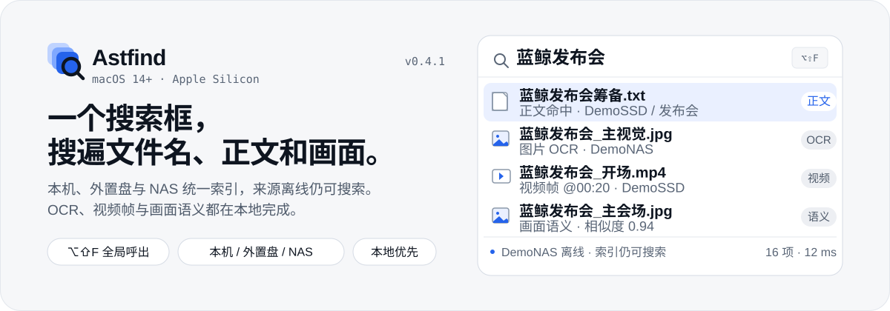
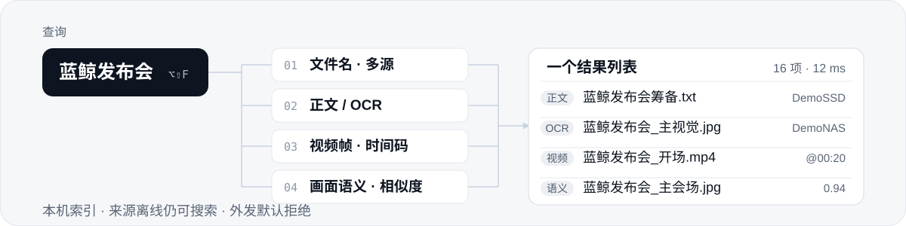
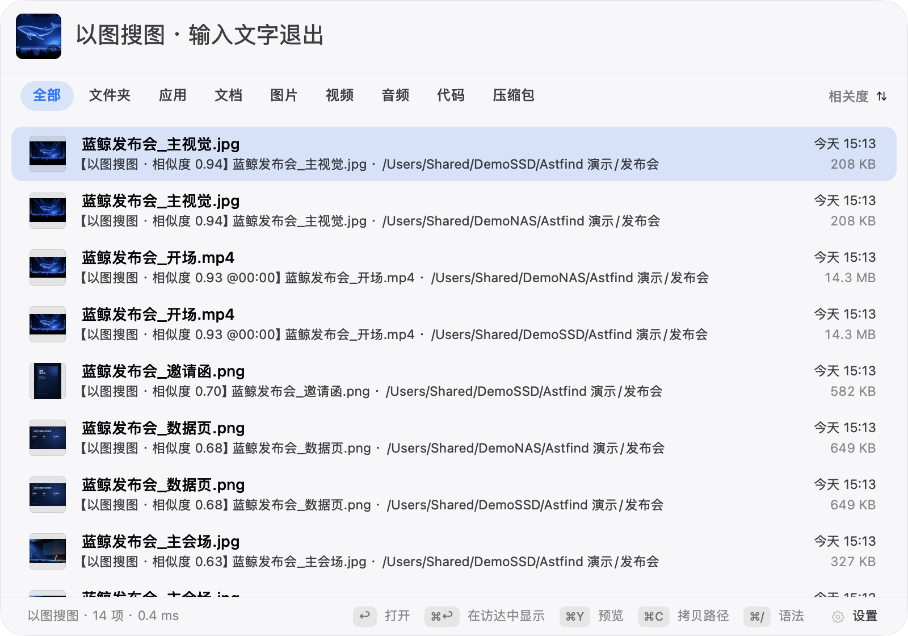

<p align="center">
  
</p>

<p align="center">
  <a href="https://astfind.robyn.top/downloads/Astfind-0.4.1.dmg"><strong>下载 macOS 版</strong></a>
  &nbsp;·&nbsp;
  <a href="https://astfind.robyn.top/">产品页</a>
  &nbsp;·&nbsp;
  <a href="docs/">文档</a>
  &nbsp;·&nbsp;
  <a href="DESIGN.md">设计规范</a>
</p>

<p align="center">
  <sub>macOS 14+ · Apple Silicon · Swift 5.10+ · v0.4.1 · 269/269 tests · Apache-2.0 + MIT</sub>
</p>

> **v0.4.1**：应用内自动更新已接通——HTTPS 同源清单、SHA-256 与代码签名校验，失败回滚。[发布说明](docs/releases/v0.4.1.md)

Astfind 是 macOS 上的本地优先统一搜索。它把本机、外置盘和 NAS 收进同一个索引，让文件名、正文、图片 OCR、视频帧文字与画面语义出现在同一个结果列表里。

## 看一次真实搜索

<p align="center">
  
</p>

<p align="center"><sub>查询「蓝鲸发布会」：正文、图片与视频命中混排；来源路径、时间码与相似度直接写在结果里。截图使用 DemoSSD / DemoNAS 虚构演示素材。</sub></p>

四条通道共用同一个结果列表，按相关度混排：

<p align="center">
  
</p>

- **文件名**：本机 / USB / SSD / SMB NAS 多源合并；来源离线后索引保留，重连自动重扫。
- **正文**：纯文本、PDF（含扫描件逐页 OCR）、图片 OCR；中文 FTS trigram 检索，命中片段高亮。
- **视频帧文字**：抽帧 OCR，命中带 `@01:23` 时间码。
- **画面语义**：自然语言搜图片与视频帧，命中带相似度与时间码。
- **类别页签**：图片 / 视频 / 文档 / 音频 / 代码 / 压缩包，对主结果与补充命中同样生效。

## 以图搜图，也是以图搜视频

<p align="center">
  
</p>

<p align="center"><sub>把图片拖进面板、按 ⌘V 粘贴，或点搜索框右侧的图片按钮；视频结果直接带命中帧与时间码。</sub></p>

- **跨源同库**：本机、外置盘、NAS 一起检索；图片与视频帧同处一张向量表，**以图搜视频是零成本副产品**。
- **右键「找相似…」**：图片结果直接以该图继续检索；视频帧命中先按时间点抽帧，再以帧为参考图（8s 看门狗，失败不拿海报冒充）。
- **视频命中跳时间点**：默认播放器是 QuickTime 时用 AppleScript 定位并播放；其他播放器或拒绝自动化授权时自动降级从头播放，右键仍可「从头播放」。
- **图文联合查询**：图片模式下继续输入文字即「图 + 文」；优先同 Provider 同空间向量加权融合（默认图片权重 0.7），融合不可用时降级为图片召回 + 文本过滤/重排，文本无命中仍保留纯图结果。
- **访达服务入口**：Finder 右键图片 → 服务/快速操作 → 「在 Astfind 中找相似」，直接以该图进入以图搜图（macOS Services，不是 Finder Sync 扩展）。
- 需在设置中开启语义检索，且当前模型支持图片输入；模型不支持时入口隐藏。查询图只走当前语义模式：本地模式零外发，远程模式受外发门控制。

实测：在 129,784 条真实向量库上，以一张本地图片查询，5.2s 返回图片与带时间码的视频帧命中；图文联合查询约 5.1–5.3s，NAS 坏文件有 15s 看门狗。

## 找人：参考照片，找到同一个人

> 实验功能 · 默认关闭 · `buffalo_sc` 权重为非商用研究许可，未随仓库或 App 分发。

参考照片 → 本机 Vision 人脸检测/五点对齐 → `buffalo_sc` CoreML 512 维向量 → 独立人脸索引。图片与视频关键帧都支持；视频 2s 起采样、长视频自适应、最多 60 帧，命中带 `@mm:ss`。

- 合影参考图显示候选脸选择条（最多 6 张），切换主脸立即重查；结果按资产去重取最佳帧。
- 人脸索引可按来源或来源内目录限定，不必为整库照片全量建库。
- 召回范围可调：严格 0.60 / 标准 0.50 / 宽松 0.35 / 高召回 0.25。
- 自测：本机 `buffalo_sc` rank1 **98.0–98.9%**、Recall@10 **100%**、查询 P95 **778–855ms**；2s 采样固定真值召回 **100%**。
- 人脸表独立于语义向量，可随时「删除全部人脸数据」。

完整参数、A/B 与视频采样记录见 [人物检索设计](docs/person-search-design.md)；模型安装见 [模型下载与配置](docs/model-setup.md#二buffalo_sc人物检索模型)。

## 本地优先，不是一个开关

- **索引在本机**：数据库在 `~/Library/Application Support/Astfind/`；OCR、PDF、文本抽取全部本地推理。
- **外发门默认拒绝**：语义模型三态是发送边界；本地只允许回环端点，远程未授权时零请求，关闭不注册图片 Provider。
- **Provider 能力要实测**：声明不等于能力，启动时探测；配置类失败不重试，环境类退避。
- **结果先到先显示**：文件名结果先行，OCR/正文毫秒级追加，语义异步二波并入；增强通道不拖慢基础搜索。
- **索引可靠性**：批量多图单请求（实测 2.5–2.9x）+ 流式攒批读写重叠；批失败二分隔离毒图/毒帧，连续失败 10 次终态跳过。
- **后台为交互让路**：面板可见/输入/打开/预览/QuickLook 时暂停新的后台扫描与内容抽取，隐藏后恢复；大型来源可按来源关闭内容 OCR。
- **来源离线可搜**：SMB 身份绑定 `smb://host/share`，换挂载点自动重绑；拔盘后索引保留并标「离线」，重连自动重扫。

| 语义模式 | 发送边界 |
|---|---|
| 关闭 | 不注册图片 Provider，远端零请求 |
| 本地 | 只允许本机回环端点，零外发 |
| 远程 | 显式授权后才请求；未授权时零请求 |

## 规模与实测

| 指标 | 实测 |
|---|---:|
| 三源索引 | 106,686 张图片 + 3,850 个视频 |
| 单库向量 | 129,784 条，本地暴力扫描毫秒级 |
| 以图搜图 | 5.2s 返回图片与带时间码的视频帧 |
| 图文联合查询 | 约 5.1–5.3s（同库） |
| 面板打开 p95 | 900ms |
| 测试 | 269/269 |

以上为项目自测，不是第三方认证或公开榜单。

## 安装

**DMG（推荐，国内优先）**：[从官网下载](https://astfind.robyn.top/downloads/Astfind-0.4.1.dmg) · [SHA-256](https://astfind.robyn.top/downloads/Astfind-0.4.1.dmg.sha256)，拖入「应用程序」。GitHub Releases 作为国际镜像。0.4.1 起支持应用内检查更新；未公证，首次打开需在「系统设置 → 隐私与安全性」放行。

**Homebrew**

```bash
brew install --cask artrobin-cn/astfind/astfind
```

> 国内网络：Homebrew cask 从 GitHub Releases 下载 DMG，可能较慢或超时；失败时请使用上面的官网直链。

**npm**（Node.js 18+）：`npm install -g @artrobin/astfind && astfind`。安装到 `~/Applications`，无需 sudo；安装前校验 SHA-256、bundle ID、arm64 与代码签名完整性。

### 第一次使用

1. 打开 Astfind，添加本机目录、外置盘或 SMB NAS 来源。
2. 等待索引；面板可见时后台扫描会自动暂停，隐藏后继续。
3. 按 `⌥⇧F` 呼出搜索框，输入关键词；也可以点图片按钮、拖入图片或按 `⌘V` 以图搜图。

全局快捷键默认 `⌥⇧F`，与上游 Oil Find 的 `⇧⌘F` 错开，设置页可改。配置语义搜索：设置页「语义模型」三选一——**关闭** / **远程** / **本地**。远程使用 OpenAI 兼容 `/v1/embeddings` 端点 + 模型名 + 显式外发授权；本地使用本机回环端点（默认 `127.0.0.1:8098`），零外发。App 不内置 Python/torch，也不下载权重；服务按 [本地语义服务指引](docs/local-semantic-server.md) 自行启动。

## 可选模型

基础的文件名、正文、OCR、视频帧文字搜索不需要任何模型。只有启用本机语义搜画面或人物检索时，才需要按需下载；App 不打包、不自动下载权重。

| 能力 | 模型 | 体积 | 配置 |
|---|---|---:|---|
| 本机语义搜图片 / 视频 | WeMM-Embedding-2B | 约 5.2GB | [Hugging Face](https://huggingface.co/tencent/WeMM-Embedding-2B) · [配置](docs/model-setup.md#一wemm-2b本机语义模型) |
| 人物检索 / 找人 | `buffalo_sc`（`w600k_mbf` → CoreML） | 13MB | [下载](https://github.com/deepinsight/insightface/releases/download/v0.7/buffalo_sc.zip) · [配置](docs/model-setup.md#二buffalo_sc人物检索模型) |
| 远程语义搜画面 | 远端 OpenAI 兼容端点 | — | 设置页「语义模型 → 远程」 |

> 权重不随仓库 / App 分发。`buffalo_sc` 为非商用研究许可，公开或商业发布前需替换或取得授权；WeMM-2B 以 Hugging Face 模型卡为准。

## 基准与口径

**A0-b 本地多模态模型对比**（自建域内 612 图配对样本，174 为独立小抽样；非公开榜单）：

| 模型 | 真值 rank1 | MRR@20 | 单图 | 峰值内存 | 外发 |
|---|---:|---:|---:|---:|---|
| **WeMM-2B（本地）** | **11/11** | **1.000** | 1.06s | 4.76GB | 否 |
| WeMM-9B（远程） | 10/11 | 0.9545 | ≈0.7s（含网络） | — | 是 |
| EmbeddingGemma 2（本地） | 7/11 | 0.818 | 0.99s | 2.95GB | 否 |
| Chinese-CLIP B/16（参考） | 5/11 | 0.636 | 39.5ms | 2.2GB | 否 |

完整脱敏说明、逐条查询、口径与复现命令见 [A0-b 本地多模态模型评测](docs/a0b-local-model-benchmark.md)；公开聚合数据见 [JSON](docs/data/a0b-benchmark-summary.json)。人脸通道自测见上节「找人」。

## 架构与开源界定

| 层 | 来源 | 许可 |
|---|---|---|
| 核心引擎（文件名索引、扫描调度） | [Oil Find](https://github.com/oil-oil/oil-find) 的 `OilFindCore`/`COilFind` 最小源码子集（上游 e63c715） | MIT |
| AstfindPanel（上游面板 fork 与修改） | Oil Find + Astfind | MIT |
| AstfindKit 搜索/索引引擎 | 本项目自研（架构源自 Oil Find） | MIT |
| AstfindKit 内容/语义模块 | 本项目自研 | Apache-2.0 |

路径级说明与二进制分发注意事项见 [LICENSING.md](LICENSING.md)；第三方声明见 [NOTICE](NOTICE)。`AstfindPanel` 是上游面板的 fork，因此该目录沿用 MIT；内容/语义模块以 Apache-2.0 发布，组合分发时分别遵守。

## 隐私

- 索引数据全部本地：`~/Library/Application Support/Astfind/`。
- 搜索反馈（搜了什么 / 打开了哪个结果 / 零结果查询）只写本机 `search-feedback.jsonl`，设置页可随时关闭，绝不上传。
- OCR / PDF / 文本抽取零外发；语义向量默认拒绝外发（外发门 + 显式授权 + 本机 Provider 视为本地推理）。
- 密钥只存引用名（环境变量 `ASTFIND_SECRET_<引用名>`），绝不明文落盘。
- 远程模式下，图片/视频语义上传的是**本地降采样缩略图**（≤1024px JPEG），非原件。

## 开发

<details>
<summary>从源码构建与 CLI</summary>

```bash
cd AstfindKit
swift test
./scripts/build-astfind-app.sh        # → build/Astfind-0.4.1.dmg + .zip

# CLI（来源管理与无头验证）
.build/debug/astfind-sources add /Volumes/SSD --name 素材盘
.build/debug/astfind-sources search 合同
.build/debug/astfind-sources semantic search "讲台上的一位老师"   # → @时间码命中
.build/debug/astfind-sources providers mode local|remote|off      # 语义模型模式
```

目录：`AstfindKit/`（主体 SwiftPM 包）、`oil-find/`（上游最小源码子集）、`AstfindPoC/`（Phase 0 验证）、`npm/`（npm 分发）、`packaging/homebrew/`（cask 模板）。

发布流程（私有开发仓 → 公开快照）见 [docs/release-process.md](docs/release-process.md)。

</details>

## 路线图

- 视频语义采样密度自适应（画面变化检测）。
- 人物检索扩大视频集复验；对外发布前替换或授权 `buffalo_sc`。
- Developer ID 签名与公证；自动更新已接通，后续补充公证与增量更新。

## 更多

- [产品页](https://astfind.robyn.top/) · [设计规范](DESIGN.md) · [部署到 Cloudflare Pages](docs/deploy-cloudflare.md)
- [以图搜图设计](docs/image-query-design.md) · [人物检索设计](docs/person-search-design.md) · [语义模型设置](docs/semantic-model-mode-design.md)
- [A0-b 本地模型评测](docs/a0b-local-model-benchmark.md) · [模型下载与配置](docs/model-setup.md) · [发布说明](docs/releases/)

## 许可

- 上游 Oil Find 快照、AstfindPanel fork 与核心搜索/索引引擎：MIT（[oil-find/LICENSE](oil-find/LICENSE)）。
- 内容/语义检索模块、CLI、测试与文档：Apache-2.0（[LICENSE](LICENSE)）。
- 模型权重不随仓库分发；WeMM 与 EmbeddingGemma 2 为 Apache-2.0，Chinese-CLIP 以模型卡为准。

核心引擎基于开源项目 [Oil Find](https://github.com/oil-oil/oil-find)（MIT License）构建延展；图片/视频内容理解（OCR 管道 · 语义向量 · Provider 体系）为 Astfind 自研模块。
